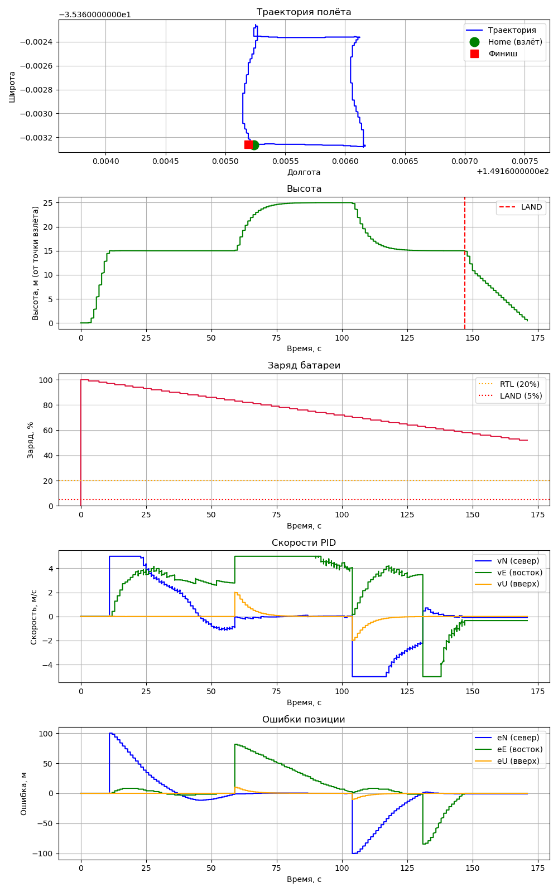

# Автономный полёт дрона с конечным автоматом на C++/ROS2 (учебный проект)

Контроллер дрона ArduPilot через ROS2 с использованием конечного автомата в однопоточном режиме (Single Thread Executor).

[](https://opensource.org/licenses/MIT)

---

## 🚀 Возможности

- **Телеметрия**: подписка на топики `/ap/geopose/filtered`, `/ap/status` и `/ap/battery`, получение координат в градусах и высоты в метрах над уровнем моря, режима, уровня заряда батареи.
- **Управление**: через вызовы сервисов ArduPilot и публикацию сообщений:
  - Переключение в режим `GUIDED`, сервис `ap/mode_switch`, номер режима 4
  - Армирование (`ARM`) сервис `ap/arm_motors`
  - Взлёт (`TAKEOFF`), сервис `ap/experimental/takeoff`
  - Переключение в режим посадки (`LAND`), сервис `ap/mode_switch`, номер режима 9.
- **Управление скоростью через PID**: публикация `geometry_msgs::msg::TwistStamped` в `/ap/cmd_vel`
 (Earth Frame, ENU). Три независимых PID-контроллера по осям X (восток), Y (север), Z (вверх) с ограничением скорости и anti-windup.
- **Асинхронность**: все вызовы сервисов выполняются асинхронно, без блокировки основного потока.
- **Тестирование**: работает в симуляторе ArduPilot SITL.
- **Обработка внештатных ситуаций**: батарея, геозона, таймаут связи.
  - При снижении уровня заряда батареи до 20% переводим дрон в режим возврата на базу (`RTL`), сервис `ap/mode_switch`, номер режима 6.
  - При снижении уровня заряда батареи до 5% - в режим посадки (`LAND`), сервис `ap/mode_switch`, номер режима 9.
  - При удалении от точки взлёта на заданное расстояние переключаемся в режим возвращения (`RTL`), сервис `ap/mode_switch`, номер режима 6.
  - При отсутствии связи более заданного интервала времени (5 сек) логируем это состояние и переходим в режим ожидания. При восстановлении связи продолжаем выполнение полёта по маршруту.
- **Задание маршрута в файле**: все точки облёта задаются в файле `src/drone_controller_cpp/src/route.csv`. Координаты широты и долготы в градусах, высота в метрах от точки старта.
- **Логирование**: запись в `track.csv` во время полёта следующей информации: время с начала полёта в секундах, координаты и высота положения дрона, заряд аккумулятора, шаг конечного автомата, режим полётного контроллера.
- **Параметры командной строки**: при запуске узла можно задавать максимальное удаление от базы и критический заряд батареи.

---

## 🎬 Демонстрация

[Автономный полёт (3 мин)](./src/drone_controller_cpp/docs/video/flight_small.mp4)

---

## 🧠 Архитектура

### Конечный автомат (`State Machine`)

```text
    INIT,
    SET_GUIDED_MODE,
    WAIT_GUIDED_RESPONSE,
    SEND_ARMING,
    WAIT_ARMING_RESPONSE,
    SEND_TAKEOFF,
    WAIT_TAKEOFF_COMPLETE,
    FLY_TO_POINT,
    RETURN_TO_BASE,
    WAIT_RTL_RESPONSE,
    SEND_LANDING,
    WAIT_LANDING_RESPONSE,
    MISSION_COMPLETE,
    ERROR
```

**Каждый шаг:**

- Отправляет асинхронный запрос к сервисам ArduPilot или публикует сообщение.
- В колбэке обрабатывает ответ и переключает состояние.
- Таймер (50 мс) управляет переходами, не блокируя поток.

### Компоненты

| Компонент | Назначение |
|-----------|------------|
| Подписка | Обновляет положение дрона, заряд батареи, режим. Колбэк короткий и неблокирующий. |
| Таймер | Запускает `control_loop()` каждые 500 мс. Управляет миссией по шагам. |
| Клиенты ArduPilot | `mode_switch`, `arm_motors`, `takeoff` — асинхронные вызовы с колбэками. |
| PID-контроллеры | Три независимых контроллера (pid_north_, pid_east_, pid_up_) вычисляют скорость по ошибке позиции. |
| Публикация скорости | TwistStamped в /ap/cmd_vel, frame_id="map" (ENU) |

## 🛠 Стек

- **OS**: `Ubuntu 22.04 LTS`
- **ROS 2**: `Humble Hawksbill`
- **DDS**: `MicroXRCEAgent` (udp4, port 2019)
- **Симулятор**: `ArduPilot SITL`
- **Язык**: `C++17`
- **Сборка** (`CMake + colcon`):
- **geometry_msgs**: `TwistStamped` для команд скорости
```bash
cd ~/ardu_ws
colcon build --packages-select drone_controller_cpp
source install/setup.bash
```

## 📁 Структура пакета
```text
drone_controller_cpp/
├── src/
│   ├── pid_twist.cpp            # Реализация узла (PID + TwistStamped)
│   ├── pid_controller.cpp       # Реализация класса PIDController
│   └── pid_controller.hpp       # Объявление класса PIDController
├── missions/
│   └── route.csv
├── CMakeLists.txt
├── package.xml
├── README.md
└── CHANGELOG.md
```
## 🚀 Запуск

### 1️⃣ Симулятор SITL (терминал 1)
```bash
cd ~/ardu_ws/src/ardupilot
./Tools/autotest/sim_vehicle.py -v ArduCopter --console --map --enable-DDS
```
### 2️⃣ MicroXRCEAgent (терминал 2)
```bash
MicroXRCEAgent udp4 --port 2019
```
### 3️⃣ Узел управления (терминал 3)
```bash
cd ~/ardu_ws
source install/setup.bash
ros2 run drone_controller_cpp pid_machine
```
### 4️⃣ Запуск с параметрами (опционально)
Все настройки можно переопределить без перекомпиляции:
```bash
ros2 run drone_controller_cpp pid_machine --ros-args -p md:=200.0 -p lb:=30.0
```

## ⚙️ Параметры

| Параметр | Тип | По умолчанию | Назначение |
|----------|-----|--------------|------------|
| `md` | int | 1000 | Предельное удаление от home, м |
| `lb` | int | 20 | Порог срабатывания RTL, % |

### Файлы проекта

| Файл | Расположение | Назначение |
|------|--------------|------------|
| `route.csv` | `share/drone_controller_cpp/missions/route.csv` | Маршрут: смещения от home в градусах (lat, lon) и метрах (alt). Копируется при сборке из `missions/` в исходниках. |
| `track.csv` | `~/drone_logs/track.csv` | Журнал полёта: секунда, координаты, высота, заряд, режим, шаг автомата. |

**Как найти установленный маршрут:**
```bash
ros2 pkg prefix drone_controller_cpp
# выведет: /home/guy/ardu_ws/install/drone_controller_cpp
# маршрут лежит в: <путь>/share/drone_controller_cpp/missions/route.csv
```

**Формат route.csv:**
```csv
lat,lon,alt
0.0,0.0,5.0
-0.0009,0.0,5.0
-0.0009,0.0009,5.0
0.0,0.0009,5.0
0.0,0.0,5.0
```

## 📊 Пример консольного вывода
```text
guy@guy-home:~$ ros2 run drone_controller_cpp pid_machine
[INFO] [1792597740.375735524] [minimal_controller]: Контроллер запущен в один поток.
[INFO] [1792597740.375974943] [minimal_controller]: Журнал полёта: /home/guy/drone_logs/track.csv
[INFO] [1792597740.425956607] [minimal_controller]: 0,0.0000000,0.0000000,0.00,0.0,STABILIZE,INIT
[INFO] [1792597740.475881918] [minimal_controller]: Запрос режима GUIDED (4)...
[INFO] [1792597740.525889911] [minimal_controller]: Запрос на ARM...
[INFO] [1792597740.544623921] [minimal_controller]: Arm response: result=1
[INFO] [1792597740.575947694] [minimal_controller]: Запрос взлета на 15 метров...
[INFO] [1792597740.585539809] [minimal_controller]: Takeoff service response received: status=1
[INFO] [1792597744.475882112] [minimal_controller]: 4,-35.3632622,149.1652374,584.19,99.0,GUIDED,WAIT_TAKEOFF_COMPLETE
[INFO] [1792597748.475901876] [minimal_controller]: 8,-35.3632622,149.1652374,592.39,98.0,GUIDED,WAIT_TAKEOFF_COMPLETE
[INFO] [1792597751.476009683] [minimal_controller]: PID: eN=0.0 eE=0.0 eU=0.4 → vN=0.00 vE=0.00 vU=0.08
[INFO] [1792597751.476262862] [minimal_controller]: Целевая точка достигнута...
[INFO] [1792597752.476012778] [minimal_controller]: 12,-35.3632584,149.1652374,599.10,97.0,GUIDED,FLY_TO_POINT
[INFO] [1792597752.476139738] [minimal_controller]: PID: eN=99.8 eE=0.0 eU=-0.0 → vN=5.00 vE=0.00 vU=-0.00
[INFO] [1792597753.525968914] [minimal_controller]: PID: eN=96.8 eE=0.0 eU=0.0 → vN=5.00 vE=0.00 vU=0.01
...
[INFO] [1792597916.477750900] [minimal_controller]: PID: eN=0.0 eE=-2.8 eU=0.0 → vN=0.00 vE=-0.28 vU=0.00
[INFO] [1792597916.777691710] [minimal_controller]: 176,-35.3632622,149.1652679,599.09,50.0,GUIDED,FLY_TO_POINT
[INFO] [1792597917.527709298] [minimal_controller]: PID: eN=0.0 eE=-2.8 eU=0.0 → vN=0.00 vE=-0.28 vU=0.00
[INFO] [1792597917.977751531] [minimal_controller]: Целевая точка достигнута...
[INFO] [1792597918.027703830] [minimal_controller]: Запрос режима LAND (9)...
[INFO] [1792597920.777789410] [minimal_controller]: 180,-35.3632622,149.1652527,596.25,49.0,LAND,WAIT_LANDING_RESPONSE
[INFO] [1792597924.827804812] [minimal_controller]: 184,-35.3632622,149.1652527,593.26,48.0,LAND,WAIT_LANDING_RESPONSE
[INFO] [1792597928.827853910] [minimal_controller]: 188,-35.3632622,149.1652527,591.24,47.0,LAND,WAIT_LANDING_RESPONSE
[INFO] [1792597932.827880671] [minimal_controller]: 192,-35.3632622,149.1652527,589.24,46.0,LAND,WAIT_LANDING_RESPONSE
[INFO] [1792597936.827885819] [minimal_controller]: 196,-35.3632622,149.1652527,587.23,45.0,LAND,WAIT_LANDING_RESPONSE
[INFO] [1792597940.828055020] [minimal_controller]: 200,-35.3632622,149.1652527,585.24,44.0,LAND,WAIT_LANDING_RESPONSE
[INFO] [1792597942.178005161] [minimal_controller]: Миссия завершена успешно!
```
## 🧪 Пример использования

### После запуска всех компонентов узел:

- Подписывается на топики `/ap/geopose/filtered` и `/ap/battery` (телеметрия).
- Автоматически отправляет команды на взлёт, PID-управление скоростью по маршруту, посадку.
- Отслеживает состояние заряда батареи, удаление от базы, связь с узлом управления.
- Выводит информацию о ходе полёта.

При успешном запуске вы увидите в консоли сообщения о взлёте, местоположении и посадке, а также перемещение дрона на карте.

### Обработка ошибок
- При снижении уровня заряда батареи до 20% выводится сообщение о возврате на базу, при снижении уровня заряда до 5% о переходе в режим посадки.
- При удалении от точки взлёта на заданное расстояние также переключаемся в режим возвращения.
- При отсутствии связи более 5 сек логируем это состояние и переходим в режим ожидания. При восстановлении связи продолжаем выполнение полёта по маршруту.

## 📈 Анализ полёта
После завершения миссии журнал полёта можно превратить в графики.

### Установка зависимостей
```bash
sudo apt install python3-pandas python3-matplotlib
```
### Запуск скрипта анализа полёта
```bash
ros2 run drone_controller plot_log ~/drone_logs/track.csv
```
Скрипт создаёт PNG с тремя графиками:
- Траектория полёта — в координатах (долгота, широта). Отмечены home и точка финиша.
- Высота от времени — вертикальные линии в моменты перехода в режимы RTL и LAND.
- Заряд батареи от времени — горизонтальные линии порогов 20% (RTL) и 5% (LAND).

### Пример


## 📌 Планы по развитию
- [x] Полёт по точкам (waypoints)
- [x] Посадка (LAND)
- [x] Обработка ошибок (таймауты, аварийная посадка при ошибке)
- [x] Обработка аварий (заряд аккумулятора, вылет за периметр)
- [x] Логирование телеметрии в CSV
- [x] Задание маршрутной карты в файле route.csv
- [x] Обработать лог файл, построить траекторию, высоту, заряд
- [x] Вынести параметры миссии в ROS-параметры
- [x] Видео полёта — записать экран с MAVProxy map
- [x] PID-регулятор для управления полётом через скорость
- [ ] Подбор Ki и Kd для точного дотягивания до точки
- [ ] Компенсация ветра (SIM_WIND_SPD)
- [ ] Расширить CSV колонками PID (vN, vE, vU, eN, eE, eU)

## [История изменений](CHANGELOG.md)

## 📚 Источники

[ArduPilot SITL](https://ardupilot.org/dev/docs/setting-up-sitl-on-linux.html)

[ROS 2 Humble](https://docs.ros.org/en/humble/)


## 📬 Контакты

Автор: [ituretsky]  
GitHub: [ituretsky](https://github.com/ituretsky)
